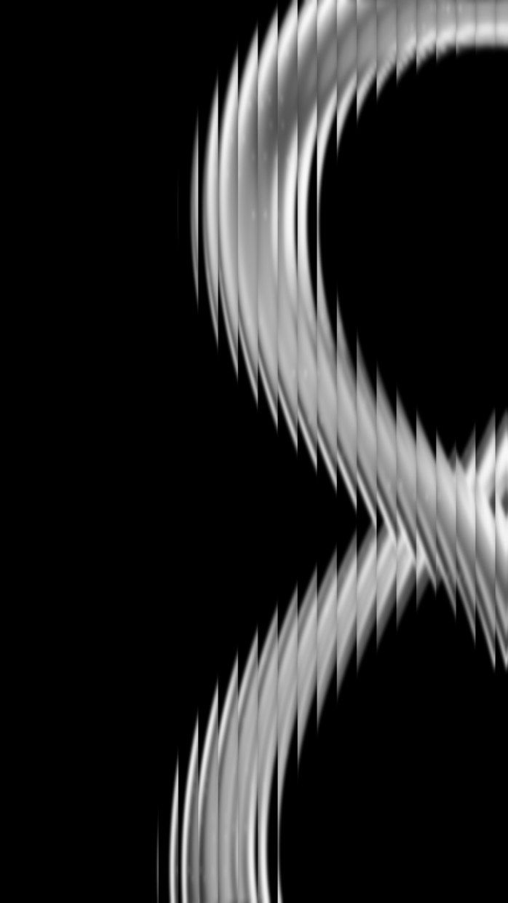

# STYLE — 골유리 모노크롬

> **뭐냐:** 검정 바탕에 매끈한 흑백 입체(고리·곡면) 하나를 판 밖으로 잘릴 만큼 크게 두고, 세로 골유리 너머로 본 것처럼 띠마다 끊어 톱날 윤곽을 만든 결. 흰색 없이 회색까지만, 빛은 위쪽에서 부드럽게.
> **언제 읽나:** 사람이 «골유리로», «그 흑백 고리 느낌으로», «플루티드» 라고 할 때. 시작 전에 끝까지.
> **안 담는 것:** 굴절 기법의 손잡이·함정 → `../../techniques/골유리_굴절.md` · 레퍼런스 원본(남의 것, 깃에 안 올림) → `../../refs/_모음/골유리_토러스/원본.webp`.

대표 그림은 **우리 재현 시험판**이다(레퍼런스는 남의 것이라 여기 두지 않는다). 확대: [띠 경계](zoom_띠경계.jpg). 레퍼런스와 나란히 본 판은 `../../runs/2026-10-22_골유리/cmp3.png`.

## 언제 쓰나 / 안 맞는 곳
- 쓰나: 폰 배경화면·스토리(9:16), 제품·상징물 하나를 고급스럽고 조용하게 보여 줄 때, 전시·브랜드 무드 포스터, 글자가 거의 없는 판.
- 안 맞음: 정보가 많은 공지 포스터(띠가 글자를 자르면 안 읽힌다 — 글자는 굴절 «위»에 얹는다), 밝고 경쾌한 행사.

## 쓴 기법 ([`techniques/`](../../techniques/README.md))
[골유리 굴절](../../techniques/골유리_굴절.md) · 입력 형태는 [3D 관 조형물](../../techniques/관_조형물_3D.md) 이나 [마크 압출 3D](../../techniques/마크_압출_3D.md)(매끈한 재질로)

## 결을 정하는 값 (레퍼런스 1125×2000 실측)
| 무엇 | 값 | 비고 |
|---|---|---|
| 판 | 세로 9:16 | 폰 화면 비 |
| 색 | 흑백만(채널 차 최대 11) | |
| 바탕 | 검정. 판의 49%가 밝기 20 아래 | |
| 밝기 상한 | 가장 밝은 곳 207(81% 회색), 99.9% 지점 190 | 🔴 순수 흰색을 쓰지 않는다 — 조용함의 핵심 |
| 밝기 넓이 | 60 넘는 곳 29%, 120 넘는 곳 12% | 밝은 곳은 고리 윗면 한 줄기 |
| 빛 | 위쪽(판 오른쪽 위 1/4 평균 66, 왼쪽 위 15) | 부드러운 넓은 빛, 반사 번쩍임 없음 |
| 형태 | 굵은 고리 하나, 구멍 가운데가 판 (가로 83%, 세로 65%) — 오른쪽 끝에서 잘림 | 밝기 무게중심 (58%, 56%) |
| 재질 | 매끈한 무광(잔무늬 없음) | 잔무늬가 있으면 굴절 앞에 흐린다(soften 7) |
| 굴절 | 띠 폭 판 폭의 3.9%, 눌러 담기 2.5배, 경계 또렷·띠 안 부드러움 | `ad fluted` 기본값 |
| 글자 | 없음 | 넣는다면 굴절 위에, 작고 가늘게(미검증) |

## 사람이 고친 것
| 날짜·건 | 사람 말 | 바꾼 값 |
|---|---|---|
| 2026-10-22 레퍼런스 | «이거 확대해 가면서 스타일이랑 기법 저장해줘» | 카드 최초 작성. 아직 이 결로 낸 결과물을 사람이 본 적 없음 |

## 다시 만드는 법
- 입력: 매끈한 무광 입체를 검정 무대에서 위쪽 넓은 빛으로 렌더(흰 번쩍임이 없게 노출을 낮춰 최대 밝기 80% 회색 근처). 판보다 크게, 한쪽 끝에서 잘리게.
- 굴절: `python -m ad fluted <렌더.png> --out <결과.png> --gray --soften 7 --blur 0.6 --seam 0.15`
- 점검: 레퍼런스 확대판(`refs/_모음/골유리_토러스/z1~z4`)과 같은 자리를 나란히 확대해 띠 경계가 또렷한지, 띠 안이 부드러운지 본다.

## 쓴 건
| 날짜 | 건 | 결과물 자리 | 비고 |
|---|---|---|---|
| 2026-10-22 | 시험(학교 무한대상 렌더) | `runs/2026-10-22_골유리/out3.png` | 레퍼런스 재현 확인용, 넘긴 결과물 아님 |

---

## 변경 이력
- 2026-10-22 — 최초 작성(사람이 준 레퍼런스를 확대·실측해서).
