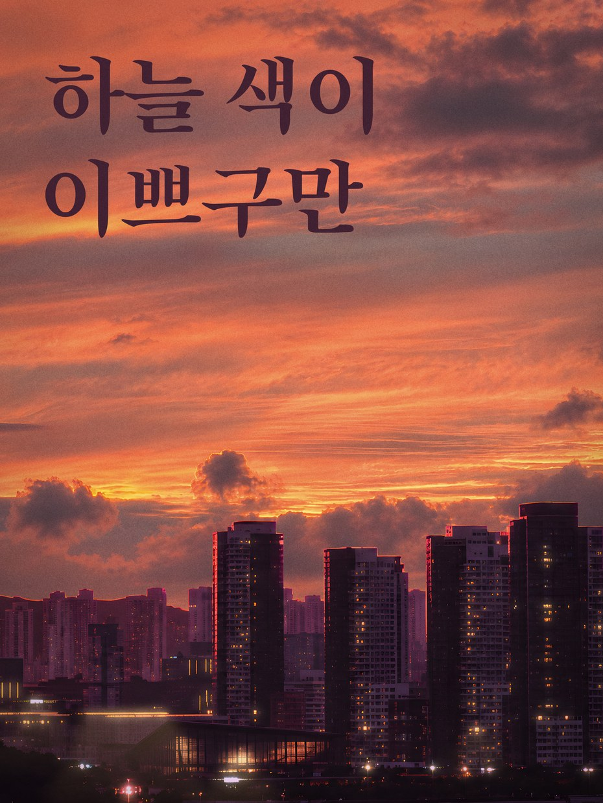

# STYLE — 노을 그레인 사진

> **뭐냐:** 노을 사진을 하늘과 도시로 나눠 다시 짓고(ChatGPT 생성 + 4배 키움), 하이라이트 번짐·빛내림·불빛 도형을 스크린으로 얹고, 필름 그레인을 맨 위에 덮은 사진 포스터 결. 제목은 붓맛 명조 한 줄 두 줄, 사진에서 딴 색 칩 여섯을 제목 아래에.
> **언제 읽나:** 사람이 «노을 포스터 결로», «사진에 그레인·하이라이트 줘서 포스터로» 라고 하거나, 풍경 사진 한 장으로 감성 포스터를 만들 때. 시작 전에 끝까지.
> **안 담는 것:** 건마다의 문구·자리 → `jobs/2026-10_노을포스터/` · 단계 → `../../protocols/promo.md` · 기법 손잡이 → `../../techniques/`.

## 언제 쓰나 / 안 맞는 곳
- 쓰나: 개인 감성 포스터, SNS 한 장, 풍경 사진 + 짧은 한마디. 사진이 흐리거나 작아도 된다(에셋을 다시 짓는다).
- 안 맞음: 기업·관공서 손님 본 사이트(«mz틱» 금지, TASTE 30), 실물 그대로가 중요한 시공 실적 사진(현실감 유지 규칙).

## 쓴 기법 (`../../techniques/`)
- [필름 그레인](../../techniques/필름_그레인.md)
- [빛 도형 하이라이트](../../techniques/빛도형_하이라이트.md) (빛내림 부채꼴 + 불빛 원근 도형)
- [포토샵 레이어 조립](../../techniques/포토샵_조립.md)

## 결을 정하는 값
| 무엇 | 값 | 비고 |
|---|---|---|
| 바탕 | ChatGPT 로 다시 지은 하늘(원본 첨부), 채도 0.82, 중간톤 +0.12 | 원본보다 «조금 밝게», 생성물이 채도가 세서 낮춤 |
| 색 | 사진 밝기 순위 99.5·85·62·40·18·3% 자리 색 여섯. 이번: #F5B860 #E17252 #B16657 #935954 #412132 #180E16 | 넓이 군집(k-means)은 어두운 색 셋이 비슷해져 버렸다 |
| 글꼴(라이선스) | 제목 송명체 SongMyung-Regular, 글자 색 = 색 칩 다섯째(자두색) · 색 코드 Pretendard Bold | 둘 다 OFL 로 알고 있다(원문 확인 못 함) |
| 크기·비율 | 3:4, 3600×4800. 제목 잉크 높이 9.8%H(2차), 왼쪽 여백 7.5%W, 위 7%H, 줄 사이 3%H. 칩 6%W, 칩 사이 2.2%W | 첫 판 6%H 를 사람이 «키워»로 올림 |
| 레이어 | 하늘 / 하늘 번짐(스크린 50) / 도시 누끼 / 빛내림(스크린 30) / 불빛 퍼짐(스크린 60) / 빛기둥(꺼 둠) / 불빛 점 번짐 / 가장자리 어둡게(곱하기) / 색 칩·코드 / 제목 / 그레인(오버레이 70) / 원본(숨김) | 도시는 판 폭의 1.3배로 키워 오른쪽 탑을 살림 |

## 사람이 고친 것 (차수마다, 사람 말 그대로)
| 날짜·건 | 사람 말 | 바꾼 값 |
|---|---|---|
| 2026-10-25 노을포스터 1차 | «에셋 형태로 내가 편집할 수 있게, chatgpt-image 로 각각 뽑아서 조합, 선명하고 크기도 큼지막하게» | 사진 보정 한 장 → 하늘·도시 생성 + 4배 키움 + PSD 레이어, 판 3024→3600 폭, 도시 1.3배 |
| 2026-10-25 노을포스터 1차 | «A안, 글자 크기는 키우고, 불빛 있는 곳 원근감 있게 도형 넣고 약간 투명도랑 그라데이션 올려서 하이라이트» | 송명체 자두색, 제목 6%H → 8.5%H, 빛 도형 레이어 셋 |
| 2026-10-25 노을포스터 2차 | «색상 rgb 랑 구름 하이라이트(구름에서 아래로 쏘는)는 빼 줘, 글씨도 조금 더 크게, 비율 유지하면서 조금 잘려도 되니까 건물 크게» → 11.2%H 를 보고 «아까랑 지금 중간 폰트로» | 색 칩·코드 뺌, 빛내림 뺌, 제목 8.5 → 9.8%H, 도시 폭 4700 → 6000(판의 1.67배, 왼쪽 산 잘림) |

## 다시 만드는 법
- 도구: `jobs/2026-10_노을포스터/work/` 의 `jobs.json`(ChatGPT 프롬프트 둘) → `python -m ad upscale` → `layers.py`(레이어 PNG) → `build_psd.py` + `build_psd.jsx`(포토샵 조립). 미리 합성은 `preview.py`.
- 바꿔 넣을 것: 원본 사진(`src/`), 제목 줄, 도시 크기(`city_w`·`city_right`), AI 가 지어 넣은 글자 지우기 상자(`erase`).
- 명령: `python .claude/skills/chatgpt-image/gen.py --out <gen> --jobs <jobs.json> --per-chat 1`(DeGaJa 에서) → `python -m ad upscale gen/sky.png --out gen/sky_x4.png` → `python layers.py` → 포토샵 띄우고 `python build_psd.py`.

## 쓴 건
| 날짜 | 건 | 결과물 자리 | 비고 |
|---|---|---|---|
| 2026-10-25 | 노을포스터(개인) | `G:\내 드라이브\SUSANNA\2026-10_노을포스터\A안_레이어_1025\` | PSD 211MB, 에셋 폴더 같이 |

---

## 변경 이력
- 2026-10-25 (이어서) — 2차: 색 칩·빛내림 뺌, 제목 9.8%H, 도시 크게.
- 2026-10-25 — 최초 작성(노을포스터 A안 레이어판).
