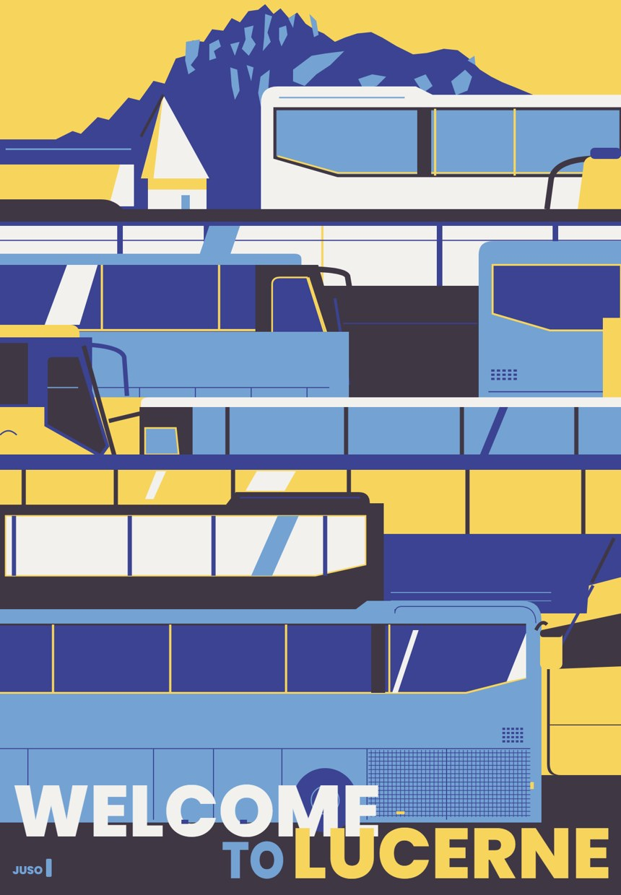

# STYLE — 루체른 평면 (다섯 색 평면 띠 포스터)

> **뭐냐:** «Welcome to Lucerne» 버스 포스터를 따라 그리며 뽑은 결. 다섯 색 평면, 노랑 대 파랑 보색, 경계의 절반이 수평, 질감과 그라데이션 없음.
> **언제 읽나:** 사람이 «루체른 결로», «그 평면 포스터 스타일로» 라고 할 때. 이 카드는 목록용이고, 본문은 아래 원문이다.
> **안 담는 것:** 스타일 시트 본문과 만드는 순서 → [`../../guides/poster_flat.md`](../../guides/poster_flat.md)(그 문서를 끝까지 읽는다) · 따라 그린 원본 → `../../runs/2026-10-15_루체른포스터/`.

## 언제 쓰나 / 안 맞는 곳
- 쓰나: 여행·지역·행사 포스터, 사물 하나를 평면 색 덩어리로 세우는 홍보물.
- 안 맞음: 수산나 본 사이트(기업·관공서 손님) — 10-15 «너무 mz틱» 판정(TASTE·LESSONS).

## 쓴 기법 ([`techniques/`](../../techniques/README.md))
[평면 다섯 색](../../techniques/평면_다섯색.md) · 배치는 [레퍼런스 해부 배치](../../techniques/레퍼런스_해부_배치.md)

## 결을 정하는 값
원문 [`guides/poster_flat.md`](../../guides/poster_flat.md) §스타일 시트 A~D 가 본체다. 요약만:
| 무엇 | 값 |
|---|---|
| 색 | 하늘 `#74A2D3` · 남색 `#3B4392` · 먹색 `#403745` · 노랑 `#F7D55D` · 흰색 `#F2F1EE`, 넓이 거의 같게, 순수 검정·흰색 안 씀 |
| 밝기 | 세 단계(밝은 둘 · 가운데 하나 · 어두운 둘) |
| 모양 | 수평 경계 49%, 사선은 한 각도(약 70°)만, 곡선은 아낌 |
| 칸 | 비슷한 스케일 ±10%, 하나만 거대 금지 |

## 사람이 고친 것
| 날짜·건 | 사람 말 | 바꾼 값 |
|---|---|---|
| 10-15 | «부족해도 한참 부족하다, 색상의 사용·모양 느낌·재질 같은 분위기» | 스타일 시트를 «무엇을 그렸나»에서 «어떻게 칠했나»로 |
| 10-15 | «너무 mz틱» | 본 사이트(기업 손님)에는 쓰지 않음 |
| 10-16 | 칸 하나만 거대·자로 잰 격자 되돌림 | 칸 스케일 ±10% |

## 다시 만드는 법
- 원문 `guides/poster_flat.md` §순서. 조립기 첫 판은 `runs/2026-10-15_루체른포스터/build.py`. 사진 → 에셋 단계는 아직 한 번도 안 해 봤다(v0).

## 쓴 건
| 날짜 | 건 | 결과물 자리 | 비고 |
|---|---|---|---|
| 2026-10-15 | 루체른 따라 그리기 | `runs/2026-10-15_루체른포스터/poster_final.png` | 처음 |

---

## 변경 이력
- 2026-10-22 — 최초 작성(스타일 대장을 만들며 기존 원문을 가리키는 카드로).
