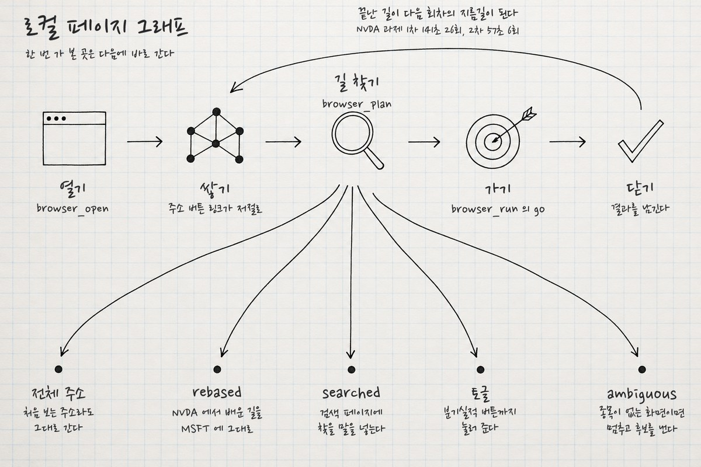

# STYLE — 연구노트 손글씨 도식

> **뭐냐:** 모눈 노트 한 장에 검정 가는 펜으로 그린 작은 낙서 아이콘과 화살표, 글자는 나눔손펜 손글씨. 상자·캡슐·색 없이 선과 빈 종이로만 구조를 보여 준다.
> **언제 읽나:** «연구노트처럼», «노트에 손으로 그린 구조도», «깔끔하게, 캡슐·상자 말고» 요청에. 시스템·절차 구조를 한 장으로 설명할 때.
> **안 담는 것:** 만드는 방법의 손잡이·함정 → [`../../techniques/무글자_밑그림_손글씨.md`](../../techniques/무글자_밑그림_손글씨.md) · 첫 건 원본 → `../../runs/2026-10-26_atlas_graph_note/`.

## 언제 쓰나 / 안 맞는 곳
- 쓰나: 내부 설명 그림, 연구·실험 기록, 절차·데이터 흐름 한 장 요약.
- 안 맞음: 손님에게 가는 공식 제안서(손글씨는 공식체가 아니다), 글이 많은 표.

## 쓴 기법 ([`techniques/`](../../techniques/README.md))
[무글자 밑그림 + 손글씨 얹기](../../techniques/무글자_밑그림_손글씨.md)

## 결을 정하는 값
| 무엇 | 값 |
|---|---|
| 종이 | 미색 바탕 + 아주 옅은 파란 모눈(ChatGPT 가 그림) |
| 선 | 검정 펜 한 자루, 가는 선, 손떨림 약간. 상자·캡슐·둥근 사각형·배지·말풍선·색 채움 금지 |
| 글자 | 나눔손펜(`refs/fonts/google/nanumpenscript`, OFL) 검정 `#18181A` 불투명 93%, 줄마다 ±0.8° 기울임 |
| 크기(1536×1024 판) | 제목 70 · 마디 이름 48 · 갈래 이름 44 · 설명 33 · 원호 설명 36/30 |
| 배치 | 글은 아이콘·점의 잉크 무게중심 아래 가운데, 판 끝 36px 안쪽으로 민다 |
| 기호 | 화살표·가운뎃점·줄표 글자 금지(RULES 산출물 2-a), 화살표는 그림 선이 한다 |

## 사람이 고친 것
| 날짜·건 | 사람 말 | 바꾼 값 |
|---|---|---|
| 10-26 첫 건 | «chatgpt 폰트 싫어서 너가 글씨 넣어줘, 구조나 디자인 캡슐 하지 말고 깔끔하게» | 그림은 글자 없이 뽑고 글자는 우리 손글씨로, 원 테두리 안(B안)은 캡슐로 보고 버림 |

## 다시 만드는 법
1. `jobs.json`(첫 건 것을 고쳐 쓴다)으로 `/chatgpt-image --per-chat 1` 두 장. 글자 금지와 «빈 종이를 남겨라»를 꼭 넣는다.
2. 고른 장에 `runs/2026-10-26_atlas_graph_note/label.py` 를 고쳐 돌린다(아이콘 띠 y, 점 띠 y, 글 목록).
3. 4분할 2배 확대로 글자가 선에 닿거나 판 끝에 잘린 데를 본다.

## 쓴 건
| 날짜 | 건 | 결과물 자리 | 비고 |
|---|---|---|---|
| 2026-10-26 | browser-atlas 로컬 페이지 그래프 구조 | `runs/2026-10-26_atlas_graph_note/로컬페이지그래프_연구노트.png` | 처음, 사람 확인 전 |

---

## 변경 이력
- 2026-10-26 — 최초 작성(로컬 페이지 그래프 구조 그림).
