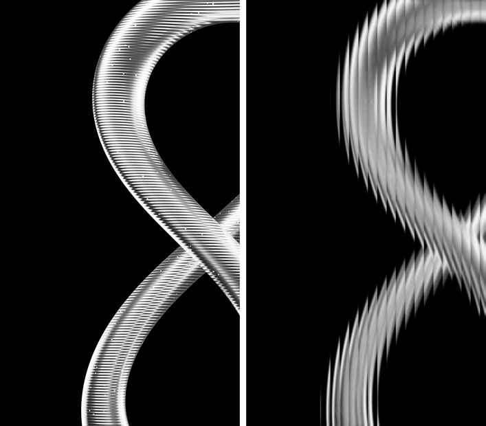
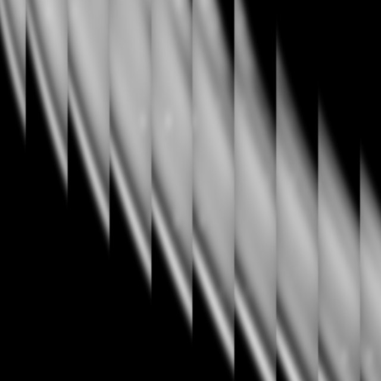

# 기법 — 골유리 굴절 (플루티드 글라스)

> **뭐냐:** 세로 골이 진 유리 너머로 본 것처럼, 판을 같은 폭의 세로 띠로 나누고 띠마다 자기 폭보다 넓은 구간을 가로로 눌러 담는다. 둥근 윤곽이 띠마다 위아래로 끊겨 톱날처럼 솟고, 띠 경계는 칼같이 또렷하다.
> **언제 읽나:** «골유리», «플루티드», «유리 너머», «세로 줄로 끊긴 듯한» 느낌을 낼 때. 사람이 준 레퍼런스(`refs/_모음/골유리_토러스/`)와 같은 결을 낼 때.
> **안 담는 것:** 이 기법을 쓴 결의 값(흑백·명암·자리) → `../styles/골유리_모노크롬/STYLE.md` · 레퍼런스 원본과 확대판(남의 것, 비공개) → `../refs/_모음/골유리_토러스/`.

## 무엇이 되나
- 넣는 것: 그림 한 장(투명 배경이면 바탕색 위에 깐다). **매끈하고 명암이 부드러운 형태일수록 레퍼런스에 가깝다.** 잔무늬(가로 홈 같은)가 많으면 띠마다 무늬가 겹쳐 지저분하다.
- 나오는 것: 같은 크기 그림 한 장.

## 레퍼런스 실측 (1125×2000, 2026-10-22)
| 잰 것 | 값 | 재는 법 |
|---|---|---|
| 띠 폭 | 44px = 판 폭의 3.9%, 판 전체에 25~26개, 판 어디서나 같음(43~47px) | 가로 밝기 차를 세로로 평균한 열 그래프의 자기상관 주기 + 봉우리 간격 |
| 눌러 담는 배수 | 약 2.5배 | 띠 안 윤곽 기울기 ÷ 띠 가운데 점들을 이은 실제 곡선 기울기(띠 열 개에서 2.37~2.61) |
| 세로 방향 | 그대로(끊김은 가로 눌림만으로 생긴다) | 띠 가운데 점들은 매끈한 원래 곡선 위에 있다 |
| 경계 | 또렷하다. 띠 «안»만 부드럽다 | 확대판 4장 |

## 손잡이 (값 → 보이는 효과)
| 값 | 효과 | 레퍼런스에 가까운 값 |
|---|---|---|
| `strip` 띠 폭 | 작을수록 잘게 부서지고 원래 형태가 덜 읽힘 | 0.039(판 폭 비율) |
| `squeeze` 눌러 담는 배수 | 1 이면 그대로, 클수록 톱날이 가파르고 띠마다 형태가 많이 반복됨. 1 아래면 띠마다 확대(볼록 렌즈 결) | 2.5 |
| `soften` 굴절 «앞» 흐림 | 띠 안이 부드러워짐, 잔무늬가 사라짐 | 잔무늬 많은 렌더 6~8, 매끈한 그림 0 |
| `blur` 굴절 «뒤» 번짐 | 크면 띠 경계까지 뭉개져 레퍼런스와 멀어진다 | 0.6 |
| `seam` 띠 가장자리 어둡게 | 유리 골 사이 그늘 | 0.15 |
| `phase` 띠 시작 어긋남 | 형태와 띠가 맞물리는 자리 | 0 |
| `gray` | 흑백 | 레퍼런스는 흑백(채널 차 최대 11) |

## 함정
- 굴절 뒤에 흐리면 경계가 뭉개진다(첫 시험에서 밟음) → 흐림은 굴절 «앞»에.
- 세로 띠라서 세로로 긴 경계(수직선)는 거의 안 변한다. 효과는 기울고 둥근 윤곽에서 가장 크게 보인다 — 둥근 형태(고리·구·곡면)를 쓴다.
- 형태가 판보다 크고 판 밖으로 잘려야 레퍼런스처럼 «가까이서 본» 느낌이 난다(작게 가운데 두면 장식처럼 보임, 미검증).

## 도구
- 경로: `../ad/fluted.py` (함수 `fluted()`)
- 명령: `python -m ad fluted <그림> --out <png> --gray --soften 7 --blur 0.6 --seam 0.15` (SusannaDesigner 에서)
- 시험 기록: `../runs/2026-10-22_골유리/`(학교 무한대상 렌더로 재현, `cmp3.png`·`cmp3_zoom.png` 가 레퍼런스와 나란히)

## 쓴 곳 · 어울림
- 스타일: 골유리 모노크롬(레퍼런스에서 뽑음, 사람 확인 전).
- 같이 쓰면 좋은 기법: 3D 관 조형물·마크 압출 3D(매끈한 입력 형태). 문자 아트와는 안 맞음(문자가 띠에 잘려 안 읽힘, 미검증).

---

## 변경 이력
- 2026-10-22 — 최초 작성. 사람: *«이거 확대해 가면서 스타일이랑 기법 저장해줘»*(흑백 토러스 레퍼런스). 확대판 넷으로 결을 보고, 띠 폭·눌림 배수를 재서 `ad/fluted.py` 로 재현.
