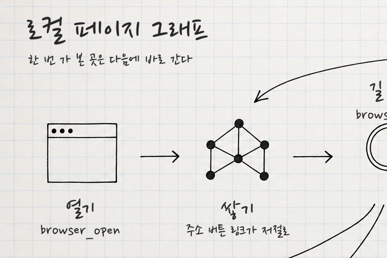

# 기법 — 무글자 밑그림 + 손글씨 얹기

> **뭐냐:** AI 에는 글자 없는 그림(아이콘·화살표·빈 자리)만 시키고, 글자는 우리가 고른 손글씨 서체로 그림에서 잰 자리에 얹는다. AI 서체 티와 깨진 한글을 피한다.
> **언제 읽나:** «AI 폰트 싫다, 글씨는 네가 넣어», 한글이 많은 도식·설명 그림, 글자 위치가 그림 요소와 맞아야 할 때.
> **안 담는 것:** 조합·값 → `../styles/연구노트_손글씨_도식/STYLE.md` · 날짜순 원문 → `../LESSONS.md` 2026-10-26.

## 무엇이 되나
- 넣는 것: 글자 금지 프롬프트로 뽑은 그림 한 장 + 글 목록(줄마다 글과 크기).
- 나오는 것: 아이콘·점 아래 가운데 맞춘 손글씨가 얹힌 PNG(원본 해상도).

## 손잡이 (값 → 보이는 효과)
| 값 | 효과 | 지금까지 받아들여진 값 |
|---|---|---|
| 자리 재기 | 띠(y 범위) 안 잉크 덩어리 가운데. 아이콘은 ±90px 안 잉크 무게중심 | 아이콘 띠 y 335~372(사이 화살표 제외), 점 띠 795~825 |
| 기울임 | 줄마다 무작위 기울임, 0 이면 활자처럼 반듯 | ±0.8° |
| 잉크 | 불투명도가 낮으면 연필, 높으면 펜 | 검정 93% |

## 함정
- 덩어리 가운데를 «아랫부분 폭»으로 재면 체크 표시가 왼쪽으로 쏠리고, «전체 폭»으로 재면 과녁이 깃털 쪽으로 쏠린다 → 잉크 무게중심.
- 아이콘 줄을 통째로 재면 사이 화살표까지 덩어리로 잡힌다 → 화살표 높이를 뺀 띠로 재고 덩어리 간격 120px 로 묶는다.
- 프롬프트에 «원 안에 아이콘»을 넣으면 원 테두리가 캡슐·배지처럼 보인다 → 낙서 아이콘만.

## 도구
- 경로: `../runs/2026-10-26_atlas_graph_note/label.py`(글 목록과 띠 y 만 고쳐 쓴다) · 서체 `../refs/fonts/google/nanumpenscript/`

## 쓴 곳 · 어울림
- 스타일: 연구노트 손글씨 도식
- 같이 쓰면 좋은 기법: (아직 없음)

---

## 변경 이력
- 2026-10-26 — 최초 작성(로컬 페이지 그래프 구조 그림).
