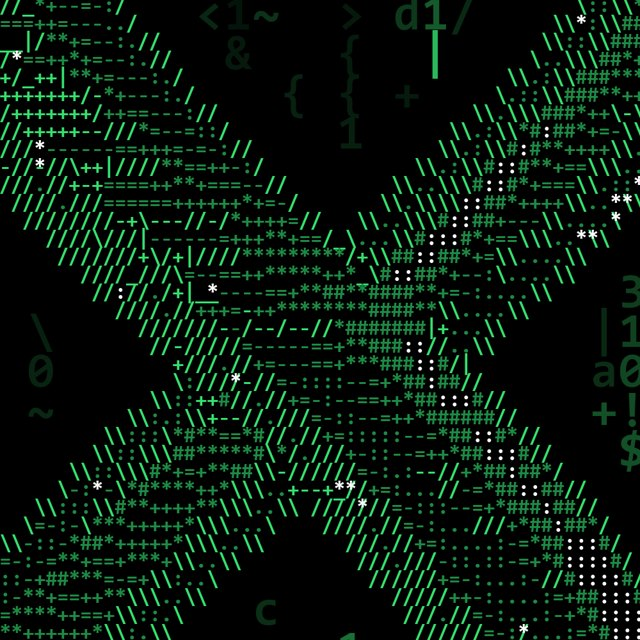

# 기법 — 문자 아트 그림

> **뭐냐:** 투명 배경 그림(렌더·사진 누끼) 한 장을 판 전체 고정폭 문자 격자로 바꾼다. 윤곽은 경계 방향 문자, 속은 밝기 단계 문자, 가장 밝은 곳과 빛점은 다른 색 문자.
> **언제 읽나:** «텍스트 아트로», «아스킷으로», «해킹 느낌으로 그림을» 요청에, 쓰기 전.
> **안 담는 것:** 이 기법을 쓴 조합 값 → `../styles/아스킷_텍스트/STYLE.md` · 함정 원문 → `../LESSONS.md` 2026-10-22 [도구] (문자 아트).

## 무엇이 되나
- 넣는 것: 판 크기 투명 PNG 한 장(그림 자리까지 잡힌 것). 점조명이 있으면 빛 번짐 PNG(`점조명_번짐.md`).
- 나오는 것: 색별 레이어 PNG 셋(윤곽 · 명암 · 빛) + 격자 원문 txt.

## 손잡이 (값 → 보이는 효과)
| 값 | 효과 | 받아들여진 값 |
|---|---|---|
| 격자 칸 `cw × ch` | 작을수록 그림이 정밀, 문자는 덜 읽힘. 칸이 1mm 아래면 회색 덩어리 | 18×28px(A3 300dpi, 약 1.5×2.4mm) |
| 고정폭 서체·크기 | 획이 굵을수록 화면이 밝다 | Consolas Bold 34px |
| 윤곽 문자 | 경계 방향: 가로 `-`·`_`, 세로 `|`, 사선 `/` `\`, 꺾임 `+` | 그대로 |
| 명암 단계 문자 | 어두움 → 밝음 순서. 칸마다 같은 몫(분위수)으로 나눔 | `. : - = + * #` |
| 빛 몫 | 가장 밝은 몇 %를 흰 문자로 | 상위 5% `:`, 점조명 `*` |
| 윤곽 문턱(`edge_on`)·Canny | 낮추면 윤곽이 두꺼워지고, 높이면 끊긴다 | 0.06, Canny 18·45, 흐림 7 |
| 색 | 윤곽 밝은 색, 명암 한 단 어두운 같은 색 | 초록 #35E06E, #1E8A45 |

## 함정
- 한 줄을 통째로 그리면 고정폭 글자 폭이 쌓여 끝에서 20px 밀린다 → 한 글자씩 칸 가운데에.
- 45° 경계는 한 줄에 칸 둘을 지나 두 겹으로 보인다. 정상이다(가늘게 하려고 문턱을 올리면 끊긴다).
- 렌더의 가는 무늬(가로 홈)가 그대로 윤곽으로 잡힌다 → 경계 찾기 전에 밝기를 흐린다.
- 명암을 따로 레이어로 둬야 «윤곽만» 판을 바로 보여 줄 수 있다.

## 도구
- 경로: `../jobs/2026-10_학교포스터/work/ascii.py` (`sculpt_layers()`), 값은 그 폴더 `spec.py` 의 `ASCII`.
- 명령: `python ascii.py` (layout.json 과 `layers/sculpt.png`·`glow.png` 를 읽음).

## 쓴 곳 · 어울림
- 스타일: 아스킷 텍스트.
- 같이 쓰면 좋은 기법: 3D 관 조형물(입력 그림), 점조명 빛 번짐(빛 문자 자리), 문자 아트 글자, 코드 비 배경.

---

## 변경 이력
- 2026-10-22 — 최초 작성(학교 포스터 3~6차).
