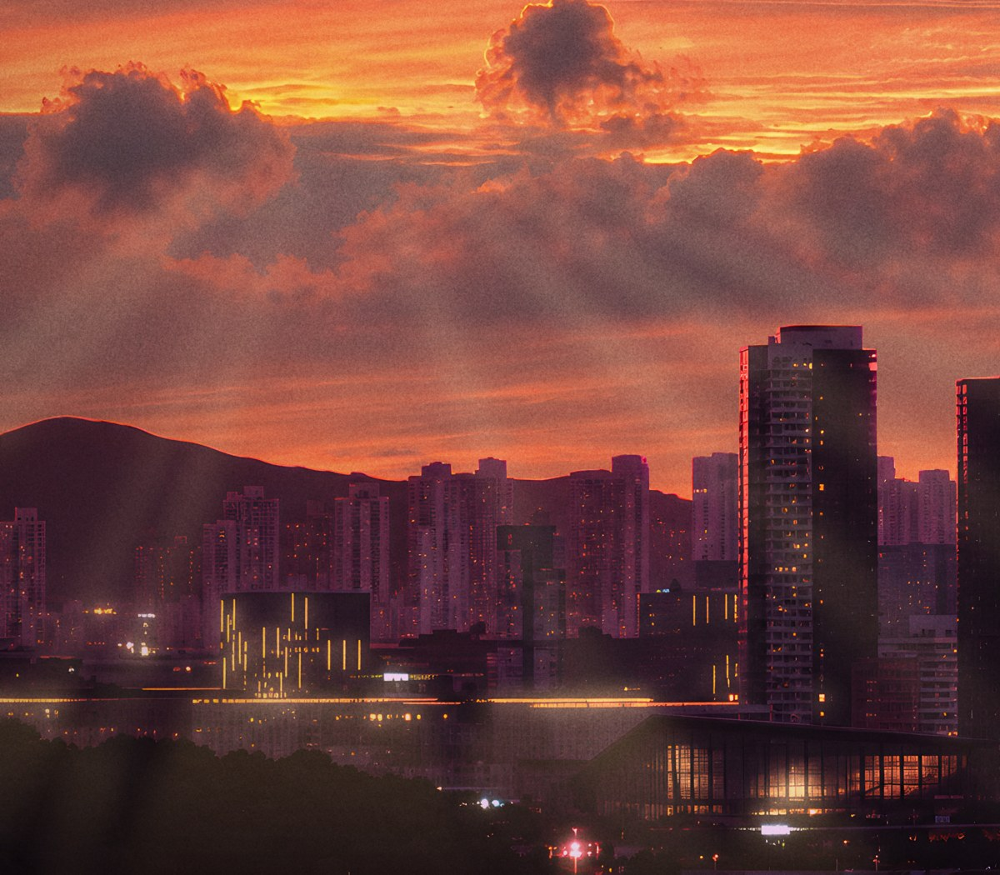

# 기법 — 빛 도형 하이라이트 (빛내림 부채꼴 · 불빛 원근 도형)

> **뭐냐:** 광원 자리에서 시작해 원근으로 넓어지는 도형(부채꼴·사다리꼴)을 그리고, 광원 쪽 진하게 → 끝 0 으로 그라데이션 투명도를 준 뒤 스크린으로 얹어 빛을 «보이게» 하는 포토샵 하이라이트 기법.
> **언제 읽나:** «불빛 있는 곳 원근감 있게 도형 넣고 투명도·그라데이션으로 하이라이트», «빛내림», «빛줄기» 요청에.
> **안 담는 것:** 조합·값 → `../styles/노을_그레인_사진/STYLE.md` · 점조명 하나만 번지게 → `점조명_번짐.md`.

## 무엇이 되나
- 넣는 것: 광원 자리(하늘은 흐린 밝기 지도의 최댓점, 도시는 밝고 따뜻한 작은 덩어리를 자동으로 찾음).
- 나오는 것: 레이어 셋, 색은 고정하고 알파에 세기를 담은 RGBA — 포토샵에서 불투명도·색을 바로 고친다.
  ① 빛내림 부채꼴: 하늘 밝은 곳에서 아래쪽 반원으로 아홉 줄기 ② 불빛 퍼짐: 도시 불빛에서 보는 쪽(아래)으로 넓어지는 사다리꼴 ③ 빛기둥: 위로 넓어지는 사다리꼴(다른 안).

## 손잡이 (값 → 보이는 효과)
| 값 | 효과 | 지금까지 받아들여진 값 |
|---|---|---|
| 도형 색 | 피치(1, .8, .58)는 주황 위에서 회색 유리처럼 떴다. 금빛(1, .74, .38)이 빛으로 읽힌다 | 금빛 |
| 가장자리 흐림 | 10px 은 도형 티가 난다. 35px 안팎이면 빛줄기 | 빛내림 34, 불빛 38 |
| 줄기 반폭 | 1.2~3.6° 무작위 | 아홉 줄기 |
| 불투명도 | 빛내림 30, 퍼짐 60 | 사람 확인 전 |

## 함정
- 도시 불빛에서 «위로» 쏘는 빛기둥은 서치라이트처럼 보여 기본에서 껐다(레이어는 남김).
- 광원은 사람이 «여기»라고 짚지 않았으면 자동으로 찾은 자리를 미리 합성으로 먼저 본다.

## 도구
- 경로: `../jobs/2026-10_노을포스터/work/layers.py` §4·4b, 미리 합성 `preview.py`

## 쓴 곳 · 어울림
- 스타일: 노을 그레인 사진
- 같이 쓰면 좋은 기법: 점조명 빛 번짐, 필름 그레인

---

## 변경 이력
- 2026-10-25 — 최초 작성(노을포스터, 사람 요청).
