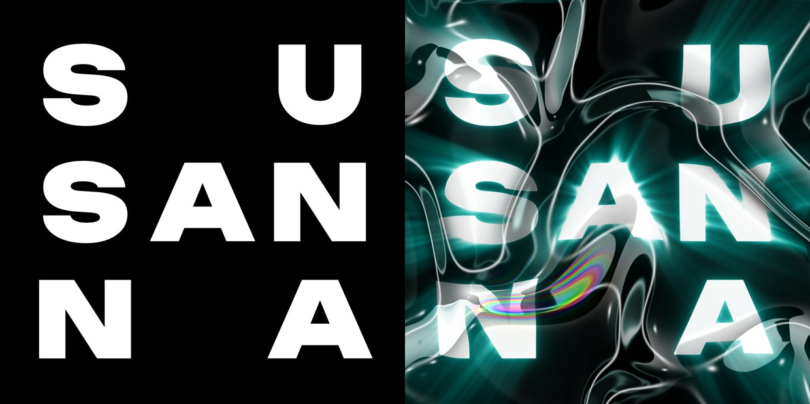

# 기법 — 액체 크롬 반사

> **뭐냐:** 출렁이는 곡면 하나를 거울 금속으로 만들어, 몸은 검정과 흰색이 크게 갈린 부드러운 반사로, 등성이는 아주 얇고 또렷한 흰 테로 보이게 한다. 바탕 그림 한 장이 판 전체가 된다.
> **언제 읽나:** «크롬», «리퀴드 메탈», «은색 출렁이는 바탕»을 낼 때. 이 기법을 추천하기 전.
> **안 담는 것:** 이 기법을 쓴 결의 값(색 넓이·명암 비율) → `../styles/액체_크롬/STYLE.md` · 레퍼런스 원본(남의 것) → `../refs/_모음/포스터_그리드/36_liquid_chrome/`.

레퍼런스 확대판은 `../refs/_모음/포스터_그리드/36_liquid_chrome/z3_가운데.png`.

## 무엇이 되나
- 넣는 것: **평면 판 한 장**(예: 검정 바탕 흰 글자). 글자를 크롬으로 만드는 게 아니라 판 «위에» 액체 금속 막을 한 장 덮는다(사람 결정 2026-10-23).
- 나오는 것: 같은 판이 막 너머로 굴절(왜곡)되고, 비탈마다 크롬 반사·흰 테·강조 하이라이트, 몇 군데 박막 간섭이 얹힌 판.

## 레퍼런스 실측 (1125×2000, 2026-10-23)
| 잰 것 | 값 | 재는 법 |
|---|---|---|
| 명암 세 몫 | 어두움 37.9% · 중간 32.5% · 밝음 29.6% | 밝기 60·200 경계 |
| 날아간 흰색 | 18.7% | 밝기 250 이상 |
| 흰 테 두께 | 중앙값 10px(판 폭 0.9%), 4~35px | 밝기 230 넘는 가로 구간 길이, 20줄마다 |
| 모양 | 곡선 86%, 사선 경계 76% | `pgrid analyze` 모양 |
| 자동 판정 | «평면 0.63» — 🔴 오판 | 아래 함정 |

## 손잡이 (값 → 보이는 효과)
| 값 | 효과 | 레퍼런스에 가까운 값 |
|---|---|---|
| `ad liquid` `scale` · `warp` · `relief` | 덩어리 크기(판 폭 비율) · 흘러내림 · 높이(클수록 크롬 넓음) | 0.30 · 0.35 · 0.08 |
| `refract` 굴절 거리 | 아래 판 글자가 밀리는 정도(왜곡) | 0.03(판 폭 3%) |
| `f0` 평평한 곳 반사율 | 낮을수록 아래 글자가 또렷 | 0.06 |
| `rim` · `spec` | 등성이 흰 테 · 점광 강조 | 0.8 · 0.9 |
| `seed` | 물결 무늬가 통째로 바뀜. 둘 이상 뽑아 고른다 | 7 · 11 |
| 노이즈 크기 | 크면 굵은 출렁임, 작으면 잔물결 | 판 폭의 약 1/4 큰 출렁임 + 그 1/3 크기 구멍(눈대중) |
| 거칠기 | 0 에 가까울수록 흰 테가 얇고 또렷 | 0.02 안팎(추정) |
| 환경 그림 대비 | 크면 몸이 검정·흰색으로 크게 갈림 | 검정 31%·흰색 26% 가 나오게 |
| 환경 그림 속 사진 | 사람·물건 사진을 섞으면 흐린 살색·물건 덩어리가 비친다 | 판 가운데 아래 하나 |
| 초점(조리개) | 열수록 가장자리가 흐려져 깊이가 생긴다 | 아래 왼쪽·왼쪽 끝 크게 흐림 |
| 노출 | 높이면 흰 면이 날아간다 | 날아간 곳 약 19% |

## 함정
- 🔴 «글자에 크롬을 입혀라»로 읽지 마라. 2026-10-23 첫 판을 글자 자체를 부풀린 크롬으로 만들었다가 사람이 멈췄다: *«평면 글자 위에 리퀴드 크롬 올리고 강조 및 왜곡 넣고 박막 간섭 넣고, 글씨에 적용하라는 게 아니라»*. 기본은 덮개다.
- 평평한 곳 반사율(`f0`)이 0.2 를 넘으면 흰 글자가 회색으로 죽는다 → 0.06.
- 노이즈를 판 끝에서 접어 쓰면(BORDER_REFLECT) 가장자리에 가로로 끊긴 띠가 생긴다 → 판 밖 15% 여유를 두고 계산한 뒤 잘라 낸다.
- `pgrid analyze` 의 «칠한 법»은 이 결을 «평면»으로 잘못 낸다(0.63). 얇은 흰 테가 날카로운 경계로 많이 잡혀서다. 이 결은 «부드러운 몸 + 얇고 또렷한 테» 두 층으로 본다. 모음표의 평면 수가 이 판만큼 부풀어 있다.
- 색 번짐을 렌즈 색수차(채널 전체 밀기)로 내면 레퍼런스와 다르다. 레퍼런스는 채널 어긋남이 아홉 칸 중 여덟 칸에서 0px 이고 색은 특정 테에만 있다 → [무지개 테](무지개_테.md).
- 압축이 심한 원본(영상 장면·배경화면 캡처)이라 확대하면 블록 번짐이 보인다. 재현할 때 이 번짐까지 따라 하지 않는다.

## 도구
- 경로: `../ad/liquid.py` (함수 `overlay()`, 평면 판은 `poster()`). 3D 길(블렌더)은 아직 안 해 봄.
- 명령: `python -m ad liquid --text "S U|SAN|N A" --font <ttf> --out <png> [--seed 7] [--glow]` (SusannaDesigner 에서). 1600px 판 한 장 약 1분.
- 시험 기록: `../runs/2026-10-23_수산나_액체크롬/`

## 쓴 곳 · 어울림
- 스타일: 액체 크롬(2026-10-23 수산나 SUSANNA 3×3 판에 처음 씀, 사람 확인 전).
- 같이 쓰면 좋은 기법: 무지개 테(색 포인트) · 마크 압출 3D(로고를 같은 재질로, 미검증) · 골유리 굴절(크롬 판을 골유리 너머로, 미검증 — 흰 테가 띠마다 끊겨 반짝임이 늘 것).

---

## 변경 이력
- 2026-10-23 (이어서) — 도구 `ad/liquid.py`(덮개 방식)로 재현. 글자 크롬으로 잘못 읽은 첫 판과 손잡이·함정을 적었다.
- 2026-10-23 — 최초 작성(레퍼런스 36 liquid chrome 해부). 재현 전.
