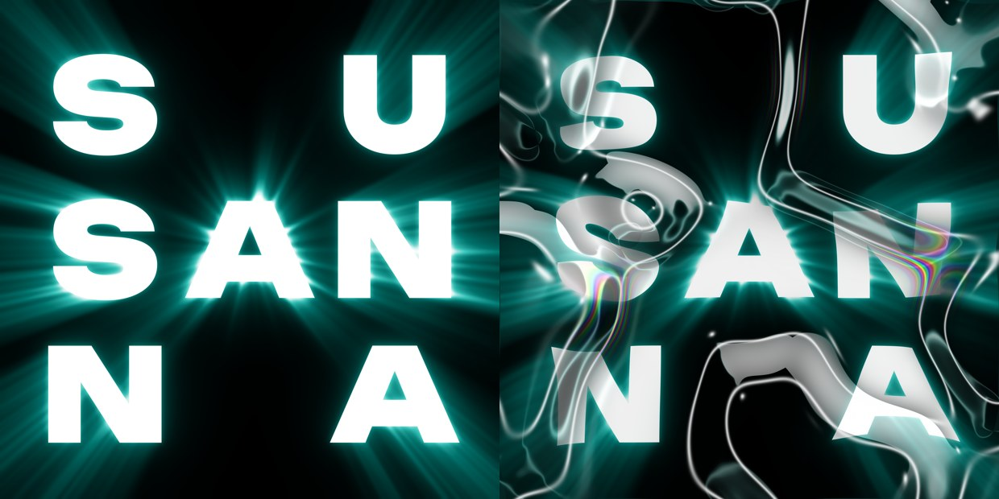

# 기법 — 역광 후광 (글자 뒤 빛)

> **뭐냐:** 글자 «뒤»에 광원을 두어, 윤곽에서 빛이 번지고(bloom) 빛줄기가 판 가운데에서 바깥으로 부챗살처럼 뻗게(god rays) 한다. 글자는 빛보다 앞에 흰 평면 그대로 서 있다. 사람 말로 «뒤에서 예수님 오신 것처럼 빛이 나게».
> **언제 읽나:** 글자·로고를 «성스럽게, 등장하듯, 뒤에서 비추듯» 보이게 할 때. 액체 크롬 덮개와 같이 쓸 때.
> **안 담는 것:** 덮개(굴절·반사) → `액체_크롬_반사.md` · 무지개 → `무지개_테.md` · 결의 값 → `../styles/액체_크롬/STYLE.md`.

## 무엇이 되나
- 넣는 것: 글자 마스크(흰 글자) + 바탕색.
- 나오는 것: 바탕에 빛을 더하고 그 위에 글자를 얹은 판. 그 판을 다시 [액체 크롬 반사](액체_크롬_반사.md) 덮개 아래에 깔면, 크롬이 빛을 굴절시켜 «막 너머로 비쳐 나오는» 결이 된다.

## 어떻게 (세 층)
1. **빛줄기**: 화면 각 점에서 광원 쪽으로 72번 표본을 모아, 그 선 위에 글자가 있으면 빛을 받는다. 그래서 빛이 글자 바깥으로 뻗는다. 각도 노이즈로 줄기를 갈라 고른 부채가 아니라 «갈라진 빛살»로 만든다.
2. **번짐**: 가우시안 세 크기(판 폭 0.6%·2.5%·8%)를 더한다.
3. **색**: 밝기를 수산나 후광 램프(검정 → 청록 700 → 청록 400 → 연청록 → 흰)로 물들이고, 덮개를 얹은 뒤 같은 빛을 12% «스크린»으로 한 번 더 얹는다. 이때 덮개 크롬은 흑백 위주 램프(`RAMP_TEALCHROME`)로 칠한다 — 청록은 빛줄기가 낸다.

## 손잡이 (값 → 보이는 효과)
| 값 | 효과 | 받아들인 값(2026-10-23 수산나) |
|---|---|---|
| `peak` 글자 밖 빛 상한 | 1 이면 글자 옆이 흰색이 되어 윤곽이 빛에 묻힌다. 낮을수록 윤곽이 또렷 | 0.72(밝은 청록에서 멈춤) |
| `rays` 빛줄기 세기 | 클수록 부챗살이 분명 | 1.8 |
| `bloom` 번짐 세기 | 클수록 글자 둘레가 뿌옇게 부풂 | 0.4 |
| `ray_len` 빛줄기 길이 | 0.8 이면 판 끝까지 뻗는다 | 0.8 |
| `ray_break` 줄기 갈라짐 | 0 이면 매끈한 부채, 1 이면 가늘게 갈라진 빛살 | 0.85 |
| `center` 광원 자리 | 판 가운데면 사방으로, 위에 두면 아래로 쏟아짐 | (0.5, 0.5) |
| `light`(덮개 위 다시 비춤) | 크롬 막 너머로 빛이 새는 정도 | 0.12 |

## 함정
- 🔴 빛 최대치를 정규화하지 않으면 글자 바로 옆이 하얗게 날아가 글자가 빛에 녹는다(첫 시험에서 밟음). 글자 «밖» 빛의 99.5% 지점을 `peak` 에 맞춘다.
- 🔴 덮개 크롬을 청록 램프로 칠하고 빛을 22% 다시 스크린했더니, 1600px 판 전체가 청록 안개가 되어 빛줄기가 안 보이고 레퍼런스의 검정 대비가 사라졌다(2026-10-23, 바탕층만 보면 멀쩡했다). → 크롬은 흑백 위주, 청록은 빛만, 다시 비춤 12%. 역광을 쓸 땐 바탕층과 덮은 판을 «둘 다» 본다.
- 계산은 판의 1/4 해상도에서 한다(빛은 부드러워 티가 안 난다). 3200px 판을 그대로 돌리면 몇 분 걸린다.

## 도구
- 경로: `../ad/liquid.py` (함수 `backlight()`, `glow_poster()`, `screen_light()`)
- 명령: `python -m ad liquid --text "S U|SAN|N A" --font <ttf> --glow --out <png>` (SusannaDesigner 에서)
- 시험 기록: `../runs/2026-10-23_수산나_액체크롬/`

## 쓴 곳 · 어울림
- 스타일: 액체 크롬(2026-10-23 수산나 SUSANNA 3×3 판).
- 같이 쓰면 좋은 기법: 액체 크롬 반사(빛을 굴절) · 점조명 빛 번짐(빛점 몇 개 더) · 마크 압출 3D(로고 뒤 역광). 골유리 모노크롬과는 안 맞음(번쩍임 없음이 그 결).

---

## 변경 이력
- 2026-10-23 — 최초 작성. 사람: *«글씨가 레퍼런스처럼 뒤에서 거의 예수님 오신 것마냥 뒤에서 빛이 나게 하는 기법을 적용하고 기법에 저장해봐»*.
