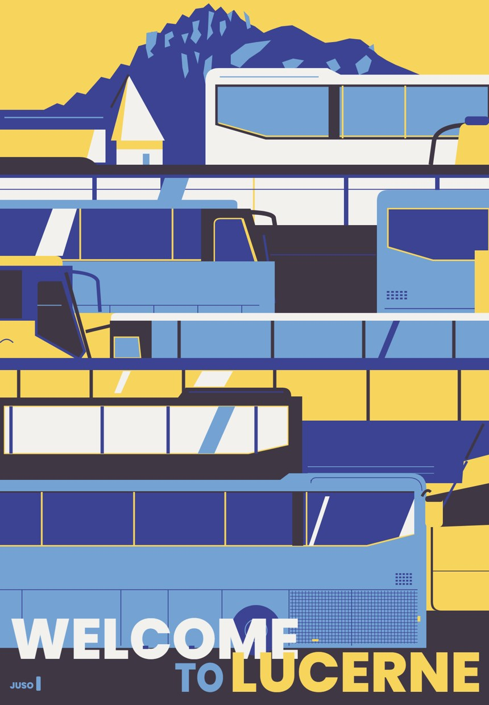

# 기법 — 평면 다섯 색

> **뭐냐:** 대상을 다섯 색 평면 층으로 칠한다. 넓이를 고르게, 밝기 세 단계, 보색 한 쌍, 질감·그라데이션 없음.
> **언제 읽나:** «루체른 결», 평면 일러스트 포스터를 만들기 전. 본문은 원문을 끝까지 읽는다.
> **안 담는 것:** 스타일 시트 본문과 순서 → `../guides/poster_flat.md`(이 카드는 목록용).

## 손잡이
- 원문 §스타일 시트 A(색 쓰는 법) · B(모양) · C·D. 핵심은 «무엇을 그렸나»가 아니라 «어떻게 칠했나».

## 함정
- 기업 손님용엔 «너무 mz틱».
- 칸 하나만 거대 금지, 자로 잰 격자 금지(±10%).
- 사진 → 다섯 색 에셋 단계는 아직 한 번도 안 해 봤다.

## 도구
- `../runs/2026-10-15_루체른포스터/build.py`(조립기 첫 판), `python -m ad vecc`(그림 → 색별 벡터).

## 쓴 곳
- 루체른 평면 스타일.

---

## 변경 이력
- 2026-10-22 — 최초 작성(원문을 가리키는 카드).
