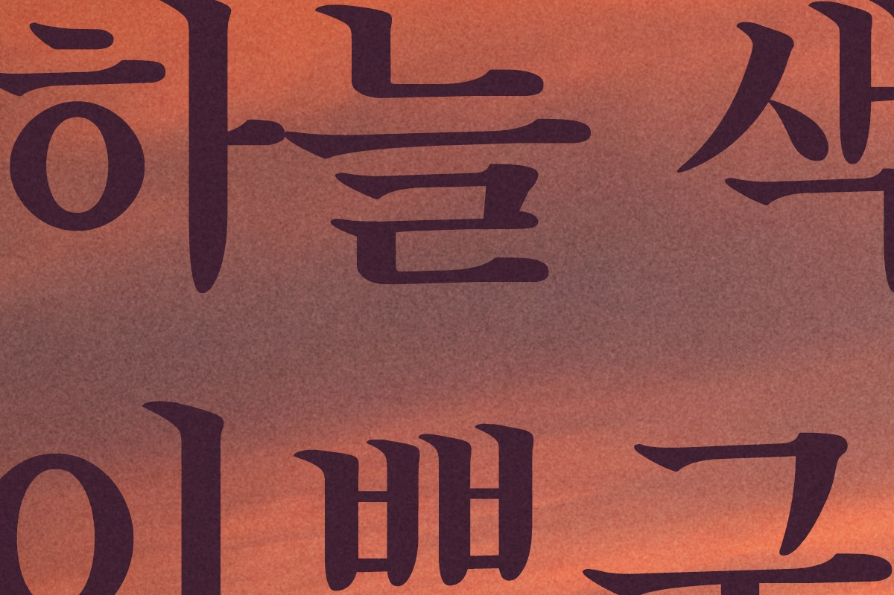

# 기법 — 필름 그레인

> **뭐냐:** 판 맨 위에 50% 회색 바탕 잡음 레이어를 오버레이로 덮어 «자글자글한» 필름 결을 준다. 글자 위에도 결이 앉아 인쇄물처럼 보인다.
> **언제 읽나:** «자글자글한 텍스처», «필름 느낌», «노이즈» 요청에. AI 생성 그림의 매끈한 티를 줄이고 싶을 때.
> **안 담는 것:** 조합·값 → `../styles/노을_그레인_사진/STYLE.md` · 날짜순 원문 → `../LESSONS.md` 2026-10-25.

## 무엇이 되나
- 넣는 것: 판 크기 정규분포 잡음(평균 128) → 가우시안 흐림 1px → 회색 PNG.
- 나오는 것: 포토샵 «오버레이» 레이어. 불투명도로 세기를 바로 고친다.

## 손잡이 (값 → 보이는 효과)
| 값 | 효과 | 지금까지 받아들여진 값 |
|---|---|---|
| 표준편차 | 클수록 거칠다 | 34(3600 폭), 오버레이 70% |
| 흐림 | 0 이면 디지털 노이즈, 1~1.5 면 필름 알갱이 | 1.0 |
| 사진에 직접 구울 때 | 중간톤에서 가장 세게(0.35 + 2.2·L·(1−L)) | 1차 사진 보정판 |

## 함정
- 폰 화면 크기(900px)로 줄여 보면 결이 거의 안 보인다. 1:1 확대로 같이 본다.
- 글자 아래에 두면 글자만 매끈해 떠 보인다 → 맨 위에.

## 도구
- 경로: `../jobs/2026-10_노을포스터/work/layers.py` §7(레이어판) · `make.py` `grain()`(구워 넣는 판)

## 쓴 곳 · 어울림
- 스타일: 노을 그레인 사진
- 같이 쓰면 좋은 기법: 빛 도형 하이라이트(빛을 더한 뒤 결로 덮으면 합성 티가 줄어든다)

---

## 변경 이력
- 2026-10-25 — 최초 작성(노을포스터).
